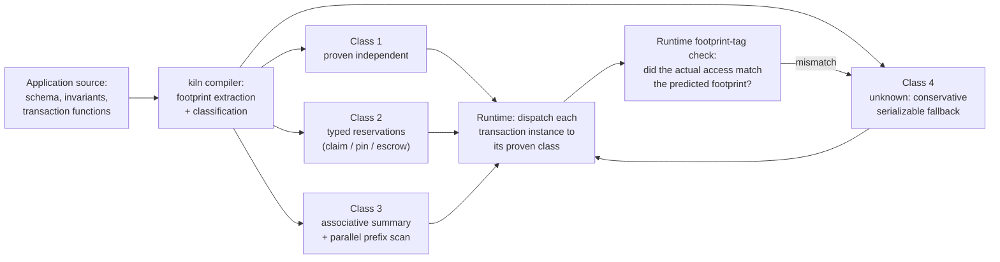

# kiln: concept and thesis

kiln is a research database engine. This document is the one place a builder
agent should need to start experiment E1 (issue #2) or E2 (issue #3), and the
one place the operator can read to understand what is being bet on and why.
Every claim of novelty below names its confidence and the file in
`docs/research/` it rests on. Nothing in this document is a measured result —
every number attached to an experiment is a target to test, not a finding.

## 1. The flipped assumption

**Term: closed world.** A database is normally built with no idea what
queries it will ever be asked. It defends itself at runtime with locks,
isolation levels, and query planning, because any client could send
anything. kiln flips this: it assumes exactly one application owns the
database, and that application's complete set of queries, transaction
functions, and declared invariants (the rules that must always hold, such as
"an email address is unique") is known before the database is built. kiln's
compiler reads that complete set once, at build time, and emits a specialized
engine for it — not a generic engine configured afterward.

This is a different sense of "closed world" than the classical database
theory term (the closed-world assumption about missing facts being false,
Reiter 1977). kiln's sense — "the full query and transaction set is known at
build time" — was not found used this way anywhere in the literature
searched; it may be genuinely new vocabulary, or simply not yet indexed under
this name (`docs/research/notes/migrations_and_combined_systems.md`, the
section on closed-world terminology, medium confidence).

**Example.** A sign-up service's entire interaction with its database is,
say, twelve functions: `create_account`, `change_email`,
`place_order`, and nine others. kiln's compiler sees all twelve at build
time — not a sample, not a guess, the actual twelve — and specializes the
engine around exactly that set. A thirteenth, never-declared query (an ad hoc
analyst query, say) still works, but through a slower, general path (see
§7).

## 2. The thesis: interference is decided at compile time, not by runtime locks

Every pair of things that might run at the same time and touch the same
state — two transaction *instances*, i.e., two actual calls to a declared
transaction function with concrete arguments — falls into exactly one of
four classes. The compiler decides which class a given pair belongs to by
analyzing the **footprint** of each transaction function: the set of rows,
index entries, and constraints it can possibly read or write, computed from
its code and its declared invariants.

1. **Proven independent.** The two footprints cannot overlap, ever, for any
   argument. They run in parallel with zero coordination.
   *Example:* two different users each updating their own profile row — one
   call touches `profile[42]`, the other `profile[917]`; the keys are
   arguments, so the compiler can prove the sets are disjoint without
   knowing the actual values at runtime.
2. **Proven compatible through typed reservations.** The footprints overlap,
   but only through an operation whose *kind* is already known to compose
   safely: a uniqueness check ("no other row may have this value") becomes a
   **claim** — an exclusive reservation on one value in an index, not a lock
   on a row; a foreign key becomes a **pin** — a reference count that blocks
   deletion of the parent, not a lock on the parent row; a numeric bound
   ("balance must stay ≥ 0") becomes an **escrow** — the available quantity
   is split into a per-caller allowance that each caller can spend locally.
   Two calls that only hit the same escrow or the same claim run in
   parallel; the reservation type decides the outcome, not a lock.
   *Example:* a ticket sale with a quota of 64 seats and 500 simultaneous
   buyers. Each `buy_ticket` call only needs an escrow draw against the
   quota — not a lock on the quota row — so all 500 calls can run in
   parallel, and the escrow mechanism alone decides which ones actually get
   a seat. A second example: two sign-ups racing to register the same email
   address both attempt the same **claim** on that value in the email
   index; exactly one claim succeeds, the other gets the correct "already
   exists" error — without ever taking a lock on an email row, because there
   is no row yet.
3. **Truly ordered on contended state.** The footprints overlap in a way
   that is not reducible to a typed reservation — the calls must observe a
   definite order to give correct answers, but that order does not have to
   be computed one call at a time. kiln compiles a batch of such calls into
   one **associative transaction summary**: a compact description of "what
   this call does to the state," such that summaries for consecutive calls
   can be *combined* instead of applied one after another. A **parallel
   prefix scan** then computes, for every call in the batch simultaneously,
   the state immediately before it ran — so every caller's result comes out
   correct, and the work is `O(n)` with only `O(log n)` dependency depth
   instead of `O(n)` sequential steps.
   *Example:* the classic "at least one doctor must stay on call" write-skew
   case. Two doctors each separately check "is at least one other doctor on
   call?" and, seeing yes, both go off call — a result no single serial
   execution would produce, because by the time the second doctor checks,
   the first has already left. Checking each transaction's precondition
   independently is unsound for exactly this invariant
   (`docs/research/notes/invariant_driven_coordination.md`, high
   confidence, citing Fekete et al. 2008 and a 2024 critique of naive
   snapshot-isolation checking). A compact summary of "go off call if and
   only if staffing stays ≥ 1" lets the batch be evaluated correctly without
   running the two requests one after another by hand.
4. **Unknown.** The compiler cannot prove either of the above — most often
   because the call is **navigational**: it reads something, then decides
   what to write based on what it read, and the write target is not a
   function of the call's arguments alone (e.g., "look up the customer by
   last name, then update whichever row that finds"). This class always
   falls back to a conservative, always-correct serializable path (§4). It
   is a safety net, never a silent approximation.

## 3. The isolation kernel: a proposal for the critic to rule on

The two ideation sources that fed this concept
(`docs/research/ideation/codex-astra-ideation.md`,
`docs/research/ideation/fable-ideation.md`) disagree on the backbone that
holds classes 3 and 4 together — the mechanism that makes "truly ordered"
and "unknown" actually safe. This section is a **proposal, not a settled
decision**; the independent critic rules on it.

**Rejected alternative (Fable's proposal): domains plus deterministic
tickets.** Partition all data along a natural ownership key (tenant,
warehouse, account). Run one single-threaded executor per domain per core,
with its own durable log — a single-domain transaction needs no lock at all;
a multi-domain transaction gets a ticket from a per-group sequencer and is
applied in that deterministic order, Calvin-style, with no two-phase commit
vote. Cost: the ownership key becomes a schema decision the compiler, not
just the analysis, must get right; a domain that attracts disproportionate
traffic becomes a serial bottleneck on one core — the documented "VoltDB
wall," where VoltDB's own multi-partition coordinator throughput degrades as
node count grows precisely because cross-partition work is serialized, not
parallelized (`docs/research/notes/static_analysis_deterministic_scheduling.md`,
citing the VoltDB Jepsen analysis and the Lotus critique of VoltDB's
multi-partition handling). Moving the ownership key later is a serial
migration of every affected row. And class 4's fallback under this design is
itself a runtime mechanism — a reconnaissance read, then resubmission, then
abort-and-retry if the footprint changed — which carries a known staleness
risk (the reconnaissance can go stale between the scouting read and the real
transaction, documented for Calvin-style scouting;
`docs/research/notes/static_analysis_deterministic_scheduling.md`, citing the
Prognosticator paper, ICDCS 2020) and is exactly the failure mode the kill
criteria name.

**Proposed kernel: strict two-phase locking over logical resources.** Treat
rows, index ranges, absent-key ranges, unique values, and parent-reference
guards as the lockable resources, held through durable commit — not table
locks, not row locks in the conventional sense, but locks on the *logical*
thing an invariant is about. A batch of class-3 calls acquires the resources
its members need, in one fixed canonical order (to make deadlock structurally
impossible rather than merely detected), proves the batch equivalent to some
serial execution inside that protected interval, and only then applies the
associative-summary/parallel-prefix-scan evaluation from §2.3 inside it.
Class 4 (unknown) uses the same lock protocol directly, with conservative
range or domain locks standing in for an un-derivable footprint — it is not a
separate mechanism, it is this kernel with a wider, safe guess at what to
lock.

**Why this is the proposal.** First, the class-3 mechanism the thesis already
commits to — associative summaries evaluated by a parallel prefix scan — was
designed together with this locking kernel in the same source
(`docs/research/ideation/codex-astra-ideation.md`); grafting it onto Fable's
domain/ticket backbone would be an unproven hybrid nobody has argued through.
Second, this kernel needs no static ownership-key assignment, so it has no
single point where a wrong schema-time guess turns into a serial bottleneck
or a disruptive migration. Third, its fallback for unknown/navigational
transactions is not a different code path with its own staleness risk — it
is the same lock protocol, just with a wider lock, which is what makes class
4 "always correct" rather than "usually correct." The cost accepted in
return: this kernel is not lock-free in the strict sense for classes 3 and 4
(it holds locks through commit, and needs deadlock-avoidance-by-ordering
bookkeeping), and it inherits two-phase locking's classic latency cost under
heavy contention — but classes 1 and 2, which the thesis expects to carry
most real traffic (per the E1 hypothesis below), never take a lock under
either proposal, so this cost is paid only where some coordination is
unavoidable regardless of kernel choice.

## 4. ACID and uniqueness

**Atomicity.** A transaction's effects are either all applied or none are,
including across the typed-reservation mechanisms of class 2: a claim, a
pin, and a row write inside one transaction either all commit together or
all roll back together, because they are recorded as one durable commit
group (§5).

**Consistency and serializable isolation (no write skew).** Class 1 is safe
because the footprints are disjoint by proof. Class 2 is safe because each
reservation type (claim, pin, escrow) is a mechanism proven, independently
of any specific transaction, to never let two concurrent uses violate its
invariant — a claim admits exactly one winner per value; an escrow never lets
the sum of allowances exceed the ceiling. Class 3 is safe because the
two-phase-locking kernel proves the batch equivalent to a real serial order
before applying it, and predicate-range locking closes the write-skew and
phantom cases the "doctors on call" example illustrates. Class 4 is safe
because it is ordinary, conservative serializable locking — the same
technique every correct database already relies on for the general case.

**Durability.** One append-only commit log per store. Every commit record
carries its effects, its outcomes, and a checksum; the record is only
visible once the file holding it has been synced to storage. Recovery
replays only commit groups whose checksum validates completely — a torn
write (power loss mid-write) is detected and the incomplete record is
discarded, not partially applied. An `fsync` failure fences the writer: it
stops accepting new work and marks the in-doubt transaction's outcome as
unknown rather than assuming failure, because an `fsync` failure does not
tell you whether the bytes reached storage
(`docs/research/ideation/codex-astra-ideation.md`, citing "Can Applications
Recover from fsync Failures?", USENIX ATC 2020). Directory entries are
fsynced too, separately from file contents, because a file can be lost after
a crash even when its own contents were durably written but its directory
entry was not.

**Uniqueness and foreign keys.** A unique index is an authoritative mapping
from `(index, value)` to a row id; inserting or changing a value requires
winning the claim on that value first — losers get the constraint-violation
error, not a lost update. A foreign key is a pin: creating a child reserves
the parent's existence for the duration of the transaction; deleting a
parent requires an incompatible reservation that first checks no live pin
remains.

## 5. Trust model

AI agents may propose new specializations — a new reservation type, a new
associative summary for a transaction family the compiler could not
classify on its own. None of these are trusted by default. A small checker
admits a proposed specialization only after proving it equivalent to the
reference semantics (the slow, obviously-correct interpretation of the same
transaction). Three independent nets catch what the checker misses: a
deterministic simulator that replays the same inputs against both the
specialized and the reference path and compares outcomes; an executable
reference model kept alongside the compiled engine specifically to diff
against; and a runtime **footprint-tag check** — every logical resource a
transaction instance actually touches is compared, at the moment of access,
against the footprint the compiler predicted for it. A mismatch aborts that
instance into the class-4 fallback and flags the specialization that
produced the wrong prediction for review, rather than silently committing a
possibly-unsound result. (This check is adapted from Fable's "runtime
domain-tag check" concept, §3, but checks footprints against the chosen
locking kernel rather than domain assignment against a partitioned
executor.)

## 6. Storage stance

The append-only log of committed facts is the only truth. Every index, every
materialized view, and every partitioning scheme is a derived, rebuildable
view of that log — none of them is allowed to be the only copy of anything.
An ad hoc read that was not in the closed workload (an analyst's one-off
query, a new report) takes a slow path: it is answered by scanning or
recomputing from the log, correctly but without the specialized speed the
compiled workload gets. This directly answers the 2026 JetStream critique of
workload-specialized engines like Bespoke OLAP — that rewriting the base
data representation around a known workload "complicates writes" and breaks
support for queries outside that workload
(`docs/research/prior-art-report.md`, §"Parts 1 through 3," and
`docs/research/notes/migrations_and_combined_systems.md`): kiln's writes
always go to the one log first, and an unanticipated read degrades rather
than breaks.

## 7. Workload migrations

A new build of the application is a new, complete transaction/query set. The
compiler diffs the old compiled program against the new one and derives
exactly which views, indexes, and reservation structures are new,
changed, or removed. New structures are backfilled from the existing log
while the old compiled version keeps serving traffic — backfill and live
traffic share the log as their one source of truth, so there is nothing to
reconcile afterward. The switch to the new version is atomic: it is the
moment both versions agree the backfill is complete. Rollback is the same
switch, run backward — because the old version's views were never deleted
until the switch succeeded, going back is not a second migration, it is just
re-pointing the live traffic.

## 8. Kill criteria

kiln's bet dies on either of these:

- **Navigational transactions dominate.** If most real transaction
  *instances* are "read, then decide what to write based on what was read"
  (class 4 by construction), the compiler has nothing to classify and kiln
  degenerates into a deterministic database with an expensive compiler
  attached — "Calvin with extra steps" — and loses on latency to a
  conventional engine. E1 (§9) measures this directly.
- **Transaction summaries do not stay compact.** If the associative
  summaries class 3 needs (§2.3) grow without bound for realistic
  contended-state transaction families — or if most such families simply
  cannot be summarized at all and fall through to the serial path — class 3
  shrinks from a foundational mechanism to a narrow optimizer that only
  helps a few hand-picked cases. E2 (§9) measures this directly.

## 9. Experiments

**E1 — classification coverage (issue #2).** Hypothesis: at least 70% of
frequency-weighted transaction *instances*, measured on TPC-C and on a
corpus of real open-source applications (candidate corpus: the 2026 study
of 111 Django/TypeORM applications named in
`docs/research/notes/open_problems_and_challenged_assumptions.md`), classify
as static or one-hop single-domain. Below 50% falsifies the thesis. This
experiment is only a footprint extractor plus classifier — no runtime, no
storage engine. The 2026 study itself reports, for the ORM-web-app slice it
covers, that 90% of its 111 applications have at least 58% of transactions
with fully inferable read/write sets up front, and that about 27% of
transactions query by a secondary attribute rather than a key — these are
that study's numbers about its own corpus, not a kiln measurement, and E1 is
how kiln checks whether its own classifier reaches 70% on that same ground
and on TPC-C, not an assumption that it already does.

**E2 — parallel evaluation of ordered transactions (issue #3).** Hypothesis:
at least 3× throughput on 16 cores, against an optimized serial-batching
baseline with identical per-call outcomes, for class-3 transaction families
such as quota allocation (the ticket-sale example, §2.3), conditional
inventory, and mixed account operations, at batch sizes 1–256.

Both thresholds, corpora, and the TPC-C/YCSB-style methodology around them
are carried over unmodified from the ideation brief
(`docs/research/ideation/codex-astra-ideation.md`,
`docs/research/ideation/fable-ideation.md`); this document does not change
them, only states them as the thing #2 and #3 must prove or falsify.

## 10. Prior art, confidence, and the closest collisions

Confidence levels below are the prior-art report's own, not restated
stronger or weaker here.

| Part of the thesis | Closest prior art | Where it stops | Confidence it is still open |
|---|---|---|---|
| Compiling a whole engine from a known workload (§1, §2.1) | **Bespoke OLAP** (2026) — LLM-agent pipeline synthesizing a whole OLAP engine from a workload contract | OLAP-only, single-threaded, in-memory; explicitly leaves transactions/concurrency as future work; no cost bound, sidesteps cost modeling entirely | Medium (`prior-art-report.md`) |
| Every index as a parameterized incremental view (§6) | DBSP/Feldera (general IVM theory), Materialize (shared "arrangement" mechanism), Noria (partial-state dataflow, 5× a hand-tuned MySQL baseline) | None sit inside an OLTP engine's own serializable transaction as the *sole* access path with no separate index concept; pg_ivm gets closest (same-transaction maintenance) but is an opt-in Postgres extension, not a replacement for indexing | Medium (`notes/incremental_views_as_unifying_concept.md`) |
| Static, build-time read/write-set derivation driving lock-free scheduling (§2.1, §2.3) | **Calvin lineage** (Calvin, Bohm, Aria, Caracal) — all derive footprints by declaration or by one runtime pass, never by static analysis of compiled code; **VoltDB** — abort-free, but by partitioning the schema and serializing cross-partition work through a coordinator | No system derives read/write sets purely as a function of a transaction's parameters, at build time | Medium-high (`notes/static_analysis_deterministic_scheduling.md`) |
| Invariants replacing isolation levels (§2.2, §3) | **Homeostasis** (2015), I-confluence, escrow, IPA/Hamsaz/Katara | Every system in this lineage targets geo-replication; none applies this reasoning to single-node, many-core concurrency control, and all live as research prototypes or CRDT-store middleware, never inside a production relational engine | Medium-high (`notes/invariant_driven_coordination.md`) |
| Migration as a diff of two compiled workloads (§7) | Schema-diff tooling (F1, CockroachDB, Atlas) and schema-less log-replay (XTDB, Datomic); Noria's "fast migrations" by reusing dataflow state | No source diffs two compiled query/transaction sets to derive a migration; the two camps (schema-diff, log-replay) have never been connected to per-query incremental materialization | Medium-high (`notes/migrations_and_combined_systems.md`) |
| Compile-time cost bounds, build-time rejection (not built in this item) | Castor (cost-guided search, no bound — "can produce layouts too large to be compiled efficiently"), AARA (proves bounds for general programs, never pointed at a query language) | No paper connects AARA-style static bounds to a database query engine | Medium-high (`notes/workload_derived_design_and_cost_bounds.md`) |
| The whole combination (all parts at once) | — | No system combines more than two of the six parts in this thesis | Medium (`prior-art-report.md`) |

The two sharpest named collisions for kiln's riskiest part (class 3,
§2.3/§9's E2) are, in order: **TransactionMerger** (submitted January
2026), which already merges contended transactions and reconstructs
per-caller results including allocated IDs — but its merged procedures are
developer-written, not compiler-synthesized, so kiln's claim narrows to
*automatic discovery* of the compact summary, which TransactionMerger does
not attempt (`docs/research/ideation/codex-astra-ideation.md`); and
**VoltDB**, the closest mechanism match for abort-free determinism generally,
which sidesteps the hard problem by requiring the developer to declare a
partition key rather than deriving one, and serializes exactly the
cross-partition case kiln's §3 kernel is chosen to avoid serializing.

## 11. Open questions for the critic

1. Is the proposed isolation kernel (§3, strict two-phase locking over
   logical resources) actually sound for class 3's associative-summary
   evaluation, or does holding locks through the parallel-prefix-scan
   computation reintroduce the serialization it was meant to avoid?
2. Does the footprint-tag runtime check (§5) catch every way a wrong
   specialization could silently produce a non-serializable result, or only
   the ones where the actual footprint is a superset/mismatch of the
   predicted one?
3. Classes 1 and 2 are proven never to need a lock under either kernel
   proposal — is that proof itself kernel-independent, or does it quietly
   assume the rejected domain model somewhere?
4. The "one-hop single-domain" criterion E1 measures (§9) is borrowed
   directly from the ideation brief without this document re-deriving it —
   is it precise enough for a fresh builder to implement a classifier
   against without guessing?
5. §7's migration story assumes the old and new compiled versions can run
   against the same log concurrently during backfill — does that assumption
   hold if a migration also changes an invariant (not just adds a view),
   where old and new versions could legitimately disagree about whether a
   past fact was ever valid?
6. Is there a cheaper experiment than E1/E2 that could kill the thesis
   faster, which this document does not name?
