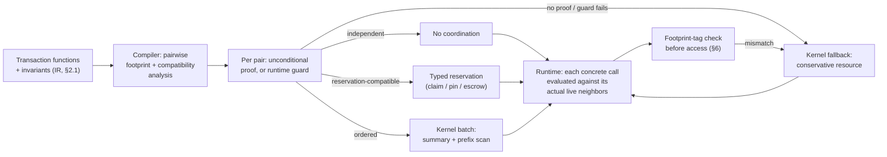

# kiln: concept and thesis

kiln is a research database engine. This document is the one place a builder
agent should need to start experiment E1 (issue #2), E2 (issue #3), or E3 (a
new item opened when this document lands), and the one place the operator
can read to understand what is being bet on and why. Every claim of novelty
below names its confidence and the file in `docs/research/` it rests on.
Nothing in this document is a measured result — every number attached to an
experiment is a target to test, not a finding. Section 9 names what this
document deliberately leaves unspecified, and why that is honest rather than
incomplete.

## 1. The flipped assumption

**Term: closed world.** A database is normally built with no idea what
queries it will ever be asked. It defends itself at runtime with locks,
isolation levels, and query planning, because any client could send
anything. kiln flips this: it assumes exactly one application owns the
database, and that application's complete set of queries, transaction
functions, and declared invariants (the rules that must always hold, such as
"an email address is unique") is known before the database is built. kiln's
compiler reads that complete set once, at build time, and emits a specialized
engine for it — not a generic engine configured afterward.

This is a different sense of "closed world" than the classical database
theory term (the closed-world assumption about missing facts being false,
Reiter 1977). kiln's sense — "the full query and transaction set is known at
build time" — was not found used this way anywhere in the literature
searched; it may be genuinely new vocabulary, or simply not yet indexed under
this name (`docs/research/notes/migrations_and_combined_systems.md`, the
section on closed-world terminology, medium confidence).

**Example.** A sign-up service's entire interaction with its database is,
say, twelve functions: `create_account`, `change_email`,
`place_order`, and nine others. kiln's compiler sees all twelve at build
time — not a sample, not a guess, the actual twelve — and specializes the
engine around exactly that set. A thirteenth, never-declared query (an ad hoc
analyst query, say) still works, but through a slower, general path (see
§7).

## 2. Language (operator ruling 15.10.2026)

kiln's engine is written in **Rust**. A parallel engine that AI agents help
build and extend needs memory safety and data-race safety enforced by the
compiler, not by agent discipline; Rust gives both with no garbage collector
to add unpredictable pauses to the latency-sensitive paths in §4 and §6. The
closest prior art made the same choice for the same reason: Turso's
ground-up rewrite of SQLite (formerly Limbo) moved to Rust specifically
because memory safety and async I/O were judged easier to get right outside
a C codebase (`docs/research/notes/open_problems_and_challenged_assumptions.md`).

What the compiler analyzes, however, is not Rust source. Application
transactions, schema, and invariants are declared in a small,
**host-language-neutral description language** — a closed vocabulary for
naming transaction functions, their parameters, and the invariants they must
keep — and it is this description that footprint extraction and
classification (§3) operate on. Rust macros are **one front end** into that
description language, convenient when the application itself is Rust, but
not the only one: any host language can target the same description
language by emitting the same declarations. This is why E1 (`docs/experiments.md`)
can classify transactions from Django and TypeORM applications — neither
written in Rust — without going through the Rust-macro front end at all.

### 2.1 A minimal semantic IR

A front end's job is to turn host-language source into one shared
**intermediate representation (IR)**: a small, fixed set of node kinds that
footprint extraction and classification (§3) analyze, regardless of which
front end produced them. Concrete syntax — how the IR is encoded on disk,
which parser library a given front end uses — is a builder's choice; what
must be fixed here is the vocabulary itself, because a fresh builder cannot
implement either E1 or E2 without knowing what a transaction function is
allowed to say.

The IR covers exactly these node kinds. Each is given with the smallest
example that shows what it means.

| IR node kind | What it expresses | Example |
|---|---|---|
| Key read | Read one row by a key that is a function of the call's arguments (or a constant). | `read(accounts, key = from_id)` |
| Range read | Read every row whose key falls in a bound that is a function of the call's arguments. | `read_range(orders, key in [start_date, end_date])` |
| Dependent read | Read something using a value produced by an earlier read in the same call — the second read's target is not known until the first one returns. | `let order = read(orders, order_id); read(customers, key = order.customer_id)` |
| Write | Insert, update, or delete one row by key. | `write(accounts, key = to_id, balance = balance + amount)` |
| Control flow | Branch on a condition built from arguments and prior reads. | `if order.status == "open" { ... } else { fail("order closed") }` |
| Bounded iteration | Repeat a body over a range whose size is statically bounded (by the schema, a constant, or an argument) — never an open-ended loop. | `for_each(line_items(order_id)) { ... }` |
| Constraint | A uniqueness, foreign-key, or numeric-bound rule attached to a table or column declaration, never written inline in a transaction body. | `unique(accounts.email)`, `bound(accounts.balance >= 0)` |
| Abort | An explicit, named rejection of the call with no effect applied. | `abort("insufficient funds")` |
| Response | A value or failure returned to the caller, kept separate from state effects so a specialization's certificate (§6) can be checked against responses on their own. | `return(granted_quantity)`, `fail(constraint_violation)` |
| Arithmetic | Operations over a declared numeric domain, with the domain's bound (if any) determining overflow behavior. | `balance + amount` over `bound(balance >= 0)` |

**Unsupported-source behavior.** A front end that meets host-language
constructs it cannot map to this table — arbitrary external I/O inside a
transaction, unbounded recursion, reflection, anything whose effect on state
cannot be pinned down by the node kinds above — does not partially
translate the function. It refuses the whole transaction function, with a
declared reason, and that function is treated as unknown (class 4, §3) in
its entirety. Partial translation would let an untranslatable side effect
hide inside an apparently-analyzed function; a whole-function refusal cannot.

**The source-to-IR boundary.** Each front end — the Rust-macro front end,
a Django or TypeORM extractor for E1, any future front end (§11) — commits
to emitting only nodes from this table, or refusing translation of the
entire transaction function it was asked to translate. There is no partial
or best-effort translation: a front end either produces IR the compiler can
analyze under §3, or it does not produce IR for that function at all.

## 3. The thesis: compile-time compatibility between transaction pairs

Whether two calls interfere is a property of a **pair** of transaction
functions, evaluated against each call's concrete arguments — not a label
the compiler can stamp on one transaction function in isolation. Two
invocations of the very same function can be independent of one concurrent
neighbor and ordered against another: two `transfer(from, to)` calls that
move money between disjoint pairs of accounts are independent of each
other; a third `transfer` call sharing an account with either of them is
not. The compiler analyzes, over the IR of §2.1, every pair of transaction
functions whose declared footprints can overlap, and for each pair proves
one of four relationships, or finds that no proof is available.

A relationship can be established two ways. An **unconditional proof** holds
for every possible argument value — for example, two calls that read and
write entirely different columns, with no argument-dependent indirection,
need no runtime check at all. An argument-dependent **runtime guard** is a
cheap check on the actual arguments of two concrete calls — for example,
"the two key arguments differ" — that must pass before the compiler's proof
is trusted for that specific pair of calls. If neither an unconditional
proof nor a passing guard is available for a pair, that pair falls back to
the conservative path (class 4) for that interaction.

1. **Proven independent.** The two footprints cannot overlap. This can be
   unconditional (different columns entirely) or guarded (the same column,
   but a runtime check on the actual key arguments).
   *Example.* Two `update_profile(user_id, ...)` calls update the same
   table and the same columns; the compiler cannot prove their footprints
   disjoint for *every* argument, because two callers could both pass
   `user_id = 42`. It instead emits a runtime guard: compare the two actual
   `user_id` values at dispatch. When they differ, the pair is independent
   and proceeds with no coordination. When they are equal — the same user's
   two concurrent requests — the guard fails and the pair is not treated as
   independent; it goes through the kernel (§4) like any other overlapping
   pair.
2. **Proven compatible through typed reservations.** The footprints overlap,
   but only through an operation whose *kind* is already known to compose
   safely, independent of the specific argument values: a uniqueness check
   ("no other row may have this value") becomes a **claim** — an exclusive
   reservation on one value in an index; a foreign key becomes a **pin** —
   a reference count that blocks deletion of the parent; a numeric bound
   ("balance must stay ≥ 0") becomes an **escrow** — the available quantity
   split into a per-caller allowance. These reservations are resources
   inside the one namespace §4 defines, and §5 specifies exactly when a
   reservation may justify a result returned to a caller.
   *Example.* A ticket sale with a quota of 64 seats and 500 simultaneous
   buyers: each `buy_ticket` call only needs an escrow draw against the
   quota, so all 500 calls can run in parallel and the escrow mechanism
   decides which ones get a seat. Two sign-ups racing to register the same
   email address both attempt the same **claim** on that value; exactly one
   wins (§5 specifies how the loser learns this safely).
3. **Truly ordered on contended state.** The footprints overlap in a way
   not reducible to a typed reservation — the calls must observe a definite
   order, but that order does not have to be computed one call at a time.
   kiln compiles a batch of such calls into one **associative transaction
   summary**: a compact description of "what this call does to the state,"
   such that summaries for consecutive calls can be *combined* instead of
   applied one after another. A **parallel prefix scan** then computes, for
   every call in the batch simultaneously, the state immediately before it
   ran — so every caller's result comes out correct, with `O(n)` work and
   only `O(log n)` dependency depth instead of `O(n)` sequential steps. This
   evaluation happens inside one batch already protected by the kernel of
   §4 (§15 distinguishes this parallelism from concurrency between batches).
   *Example.* The classic "at least one doctor must stay on call" write-skew
   case. Two doctors each separately check "is at least one other doctor on
   call?" and, seeing yes, both go off call — a result no single serial
   execution would produce, because by the time the second doctor checks,
   the first has already left. Checking each transaction's precondition
   independently is unsound for exactly this invariant
   (`docs/research/notes/invariant_driven_coordination.md`, high
   confidence, citing Fekete et al. 2008 and a 2024 critique of naive
   snapshot-isolation checking). A compact summary of "go off call if and
   only if staffing stays ≥ 1" lets the batch be evaluated correctly without
   running the two requests one after another by hand.
4. **Unknown.** Neither of the above is available for a pair — most often
   because one side is **navigational**: it reads something, then decides
   what to write based on what it read, and the write target is not a
   function of the call's arguments alone (e.g., "look up the customer by
   last name, then update whichever row that finds"), so the footprint
   itself cannot be derived. It also covers a pair whose footprints *are*
   individually known but for which no unconditional proof or guard
   establishes classes 1–3. This class always falls back to the kernel's
   conservative path (§4). It is a safety net, never a silent
   approximation.

At runtime, kiln never tags one concrete call with a single fixed class.
Each call is evaluated against every other call it currently overlaps with,
using the pairwise proof the compiler produced for that pair; a call with no
overlapping neighbor proceeds uncoordinated, a call whose every overlapping
neighbor is reservation-compatible goes through the typed-reservation
mechanisms, and a call with any ordered or unprovable neighbor enters the
kernel of §4 together with that neighbor.

## 4. The isolation kernel: one resource protocol for every path

The two ideation sources that fed this concept
(`docs/research/ideation/codex-astra-ideation.md`,
`docs/research/ideation/fable-ideation.md`) disagree on the backbone that
holds classes 3 and 4 together — the mechanism that makes "truly ordered"
and "unknown" actually safe. This section is a **proposal, not a settled
decision**; the independent critic rules on it.

**Rejected alternative (Fable's proposal): domains plus deterministic
tickets.** Partition all data along a natural ownership key (tenant,
warehouse, account). Run one single-threaded executor per domain per core,
with its own durable log — a single-domain transaction needs no lock at
all; a multi-domain transaction gets a ticket from a per-group sequencer and
is applied in that deterministic order, Calvin-style, with no two-phase
commit vote. Cost: the ownership key becomes a schema decision the
compiler, not just the analysis, must get right; a domain that attracts
disproportionate traffic becomes a serial bottleneck on one core — the
documented "VoltDB wall," where VoltDB's own multi-partition coordinator
throughput degrades as node count grows precisely because cross-partition
work is serialized, not parallelized
(`docs/research/notes/static_analysis_deterministic_scheduling.md`, citing
the VoltDB Jepsen analysis and the Lotus critique of VoltDB's
multi-partition handling). Moving the ownership key later is a serial
migration of every affected row. And class 4's fallback under this design
is itself a runtime mechanism — a reconnaissance read, then resubmission,
then abort-and-retry if the footprint changed — which carries a known
staleness risk (documented for Calvin-style scouting;
`docs/research/notes/static_analysis_deterministic_scheduling.md`, citing
the Prognosticator paper, ICDCS 2020) and is exactly the failure mode the
kill criteria name.

**Proposed kernel: strict two-phase locking over one shared resource
namespace.** Every path — classes 1 through 4, specialized or fallback —
acquires its resources from the same namespace, held through durable
commit: rows, index ranges, absent-key ranges (for phantom protection),
and the typed reservations of §3.2 (a claim, a pin, an escrow draw) are all
resources in this one namespace, not separate mechanisms bolted on beside
it. This is the direct fix for a gap in an earlier draft of this document:
a class-4 call holding a range lock and a class-2 call inserting a new
value into that same range must be able to see and order against each
other. Concretely, an insertion that creates a new value acquires its typed
claim *and* is checked against any range or absent-key resource covering
the point it inserts into (next-key locking), so a reader's range lock and
a writer's claim on a value inside that range conflict correctly instead of
racing past each other.

A batch of class-3 calls acquires the resources its members need, in one
fixed canonical order (to make deadlock structurally impossible rather than
merely detected), proves the batch equivalent to some serial execution
inside that protected interval, and only then applies the
associative-summary/parallel-prefix-scan evaluation from §3.3 inside it.

**Lock elision is a whole-program decision, not a pairwise one.** A
specialized path (class 1) is only permitted to skip the shared namespace
entirely — to take no lock at all — when the compiler's proof of
disjointness holds against every function in the compiled program that can
touch the same declared footprint region, including whatever class 4 could
touch there, not merely against the one neighbor a given proof happened to
be checked against. In practice this means: if any transaction function in
the program can reach a given row, range, or value through a navigational
(class-4) path, that region is never eligible for class-1 elision for *any*
function, and every access to it — specialized or not — goes through the
namespace. Elision is sound exactly because it is decided once, per
resource region, across the whole compiled program — never negotiated at
runtime between two calls that happen to meet.

**Unknown footprints acquire a genuinely conservative covering resource
before access.** Class 4's conservative guess is acquired in the same
namespace, before any read or write touches the underlying state — never
after a reconnaissance read, which is exactly the staleness risk the
rejected alternative accepts and this kernel refuses. The covering resource
is a static over-approximation derived from whatever the call's arguments
do constrain (a whole table when nothing is statically bounded, a range
when the arguments bound one). If the navigational code's possible access
cannot be bounded at all — unbounded fan-out through recursive lookups,
say — that is a translation failure under §2.1's unsupported-source rule,
rejected at compile time, not a runtime surprise discovered after the fact.

**Lock expansion restarts safely.** If a class-4 call's covering resource
must widen mid-execution and acquiring the wider resource would violate the
kernel's fixed canonical ordering, the call never acquires out of order —
doing so would reintroduce the deadlock risk the ordering exists to avoid.
Instead it discards its tentative effects and restarts from the beginning
with the wider resource acquired first, in canonical order.

**Why this is the proposal.** First, the class-3 mechanism the thesis
already commits to — associative summaries evaluated by a parallel prefix
scan — was designed together with this locking kernel in the same source
(`docs/research/ideation/codex-astra-ideation.md`); grafting it onto
Fable's domain/ticket backbone would be an unproven hybrid nobody has
argued through. Second, this kernel needs no static ownership-key
assignment, so it has no single point where a wrong schema-time guess turns
into a serial bottleneck or a disruptive migration. Third, its fallback for
unknown/navigational transactions is not a different code path with its own
staleness risk — it is the same lock protocol, just with a wider lock,
which is what makes class 4 "always correct" rather than "usually
correct." The cost accepted in return: this kernel holds locks through
commit for classes 3 and 4, with deadlock-avoidance-by-ordering
bookkeeping, and inherits two-phase locking's classic latency cost under
heavy contention — but classes 1 and 2, which the thesis expects to carry
most real traffic (per the E1 hypothesis below), never take a lock under
either proposal, so this cost is paid only where some coordination is
unavoidable regardless of kernel choice.

## 5. ACID and uniqueness

**Atomicity.** A transaction's effects are either all applied or none are.
Its claims, pins, escrow draws, and row writes are recorded as one durable
commit group (§9.1): if the transaction aborts for any reason — including a
constraint failure discovered later in the same transaction — every
reservation it tentatively held is released atomically with its other
effects. No reservation outcome is ever visible to another transaction
before the transaction holding it commits.

**Tentative versus committed reservations.** A reservation exists in one of
two states: **tentative**, held by an in-flight, uncommitted transaction, or
**committed**, held by a transaction that has durably committed. Only a
committed reservation may justify a semantic failure returned to a caller.
A transaction that encounters a *tentative* claim already held by another
in-flight transaction does not immediately fail with "already exists": the
kernel of §4 orders it behind the holder and it waits for the holder's
outcome. If the holder commits, the waiter's claim fails with the
uniqueness error — now justified by a real serial order, because the
holder's commit genuinely happened first. If the holder aborts, its
tentative claims are released and the waiter proceeds as if the value had
never been claimed. This replaces an earlier, unsound shortcut: letting a
transaction return "already exists" the moment it loses a merely tentative
claim can report an error no serial execution would have produced, if the
winning claim's holder later aborts on an unrelated constraint.

**Consistency and serializable isolation (no write skew).** Class 1 is safe
because the footprints are disjoint by proof or passing guard (§3). Class 2
is safe because each reservation type is a mechanism proven, independently
of any specific transaction, to never let two concurrent uses violate its
invariant — a claim admits exactly one *committed* winner per value; an
escrow never lets the sum of committed allowances exceed the ceiling — and
because tentative contention is resolved by waiting on a real commit order,
never by trusting an uncommitted holder. Class 3 is safe because the
two-phase-locking kernel proves the batch equivalent to a real serial order
before applying it, and next-key locking (§4) closes the write-skew and
phantom cases the "doctors on call" example illustrates. Class 4 is safe
because it is ordinary, conservative serializable locking — the same
technique every correct database already relies on for the general case.

**Foreign keys: durable reverse references.** A pin is not scoped to the
lifetime of the transaction that created it. Creating a child row installs
both the pin and a durable **reverse reference** — committed state
recording every live child referencing a given parent — and that reverse
reference persists for as long as the child row exists, not merely through
the child's own insert transaction. Deleting a parent requires acquiring an
incompatible reservation against the parent's reverse-reference set itself,
checked under the same kernel protocol as any other resource access: the
deletion only commits if that set is empty at the deleting transaction's
own commit point. This closes a lifetime gap in an earlier draft, where a
pin held only through the child's insert could disappear by the time an
unrelated parent-deletion transaction ran, letting the parent be deleted
despite a live, committed child — the same durable-reference requirement
the ideation source specifies
(`docs/research/ideation/codex-astra-ideation.md:103`).

**Durability.** A commit, once acknowledged, is durable. The exact storage
failure model — what "once acknowledged" protects against, and what it does
not — is specified precisely in §9.2; this document's architecture-level
commitment is a single append-only commit log per store, with recovery
replaying only commit groups that validate completely.

## 6. Trust model

AI agents may propose new specializations — a new reservation type, a new
associative summary for a transaction family the compiler could not
classify on its own. None of these are trusted by default. Before a
proposed specialization is admitted, it must carry a **certificate**: a
proof, checked by a small checker, that the specialization preserves — for
every valid state and every argument the reference semantics accepts — the
final state, every response and every failure the reference semantics could
produce, every declared constraint (uniqueness, foreign key, numeric
bound), arithmetic overflow behavior, and any ordering requirement the
reference semantics relies on. A certificate is bound to a specific
semantic version and schema version; a specialization is valid only while
execution stays inside those versions, and a new build invalidates every
certificate issued against the prior version. The certificate's proof is
what admits a specialization — the mechanisms below are not a substitute
for it.

Three detection mechanisms catch what a checker's proof might still miss in
practice — a bug in the checker, not a gap in what the certificate
promises — and all three are additional detection, never the admission
criterion: a deterministic simulator that replays the same inputs against
both the specialized and the reference path and compares outcomes; an
executable reference model kept alongside the compiled engine specifically
to diff against; and a runtime **footprint-tag check** that compares, at
the moment a transaction instance is about to acquire access under the
kernel of §4, the resources it is about to touch against the resources its
certificate declared it would need. A mismatch is caught **before**
access: the instance's acquisition is refused, every tentative effect it
has already produced is discarded, and the whole transaction restarts
through the class-4 fallback, with the mismatching specialization flagged
for review. Passing the simulator, the reference-model diff, or the tag
check on a finite set of observed executions never by itself proves a
specialization sound — only the certificate's proof does that; detection is
a safety net for checker failure, not evidence of correctness on its own.

## 7. Storage stance

The append-only log of committed facts is the only truth. Every index, every
materialized view, and every partitioning scheme is a derived, rebuildable
view of that log — none of them is allowed to be the only copy of anything.
An ad hoc read that was not in the closed workload (an analyst's one-off
query, a new report) takes a slow path: it is answered by scanning or
recomputing from the log, correctly but without the specialized speed the
compiled workload gets. This directly answers the 2026 JetStream critique of
workload-specialized engines like Bespoke OLAP — that rewriting the base
data representation around a known workload "complicates writes" and breaks
support for queries outside that workload
(`docs/research/prior-art-report.md`, §"Parts 1 through 3," and
`docs/research/notes/migrations_and_combined_systems.md`): kiln's writes
always go to the one log first, and an unanticipated read degrades rather
than breaks.

This section commits to indexes and views being derived and rebuildable
from the log — it does not commit to every index being a compiled,
parameterized incremental view in the sense §15 surveys as prior art; that
stronger claim is a deferred hypothesis (§15), not part of the present
architecture.

## 8. Workload migrations

A new build of the application is a new, complete transaction/query set. The
compiler diffs the old compiled program against the new one and derives
exactly which views, indexes, and reservation structures are new, changed,
or removed. New structures are backfilled from the existing log while the
old compiled version keeps serving traffic. The switch to the new version is
atomic. Rollback reuses the same switch mechanism, run backward.

The architecture-level commitment here is that migrations are driven by a
diff of two compiled programs against one shared log, not by hand-written
ad hoc migration scripts. The precise watermark that bounds "backfilled
from the existing log," the catch-up coordination during backfill, and the
conditions under which rollback is actually available are named as an
engine-phase obligation in §9.3 — they are not yet a specified protocol.

## 9. Engine-phase obligations

Three correctness obligations belong to the engine build, not to this
concept: each is stated here precisely enough that no engine built against
this document can honestly ignore it, with the direction this document
commits to and the conditions under which that direction fails — but the
exact protocol is not yet specified, and a builder implementing it owns
writing that protocol down before shipping it.

### 9.1 Publication boundary

**Obligation.** After a transaction commits effects touching more than one
derived structure (an index, a view, a reverse-reference set, §5), no
reader may ever observe a state reflecting some but not all of those
effects — not during normal operation, and not during recovery after a
crash. A durable log record proves a commit is recoverable; it does not by
itself prove every reader sees that commit's effects atomically, and this
document does not claim otherwise.

**Chosen direction.** Readers see committed state through a single,
monotonically increasing *visible version* pointer. A commit's
derived-structure updates are prepared independently of readers and become
visible only when that pointer advances past the commit, in one atomic
step. The log append is the source of truth for what has committed; the
visible-version pointer is a cache that can always be rebuilt from the log.

**Failure conditions.** If a crash occurs after the log records a commit
but before every derived structure has finished installing, recovery must
either finish installing them before advancing the pointer past that
commit, or must not advance the pointer past it at all. One log may back
more than one logical store within it; this boundary's atomicity is scoped
to the commits recorded in one log, never implied across two independent
logs.

**Status: not yet specified.** The exact pointer or version representation,
how far ahead installation of derived structures may run, and the recovery
procedure that re-derives or replays incomplete installation are engine-
phase work.

### 9.2 Storage failure model

**Obligation.** A committed record, once acknowledged, must survive every
failure within the storage system's declared failure granularity. Detecting
corruption in a newly appended record must never be the mechanism relied on
to protect a previously acknowledged record — checksum detection on the new
record proves nothing about damage to older, already-durable bytes.

**Chosen direction.** Commit records are framed (length and digest) and
validated on read. A flush is trusted to be truthful: if it reports success,
the bytes are durable, consistent with the cited study's own framing; an
`fsync` failure fences the writer — it stops accepting new work rather than
retrying and assuming success repaired anything — because an `fsync`
failure does not tell you whether the bytes reached storage
(`docs/research/ideation/codex-astra-ideation.md`, citing "Can Applications
Recover from fsync Failures?", USENIX ATC 2020,
[PDF](https://www.usenix.org/system/files/atc20-rebello.pdf)). New commit
records are appended only into storage regions the engine has not
previously acknowledged as committed — fresh aligned extents, or
copy-on-write rather than in-place overwrite of a committed extent — so a
torn write to a new record can never reach into bytes a caller was already
told are durable. Directory entries are fsynced separately from file
contents, because a file can be lost after a crash even when its own
contents were durably written but its directory entry was not.

**Failure conditions.** A torn write to a new, not-yet-acknowledged record
is detected by its framing and the incomplete record is discarded safely —
nothing was promised durable yet. A torn write that reaches into
already-acknowledged bytes, or a storage device that lies about a flush,
is outside this model: the engine cannot repair it, and recovery must
surface the failure rather than silently skip the damaged record.
[SQLite's own atomic-commit documentation](https://www.sqlite.org/atomiccommit.html)
makes the same truthful-flush assumption for the same reason.

**Status: not yet specified.** The exact extent size, the allocation and
reclaim policy, and the checkpoint layout that make "never overwrite
acknowledged bytes" concrete are engine-phase work.

### 9.3 Migration watermark and rollback window

**Obligation.** After the compiler diffs two program versions, the new
structures it backfills must reflect every commit up to a definite point in
the log, with no gap and no duplicate. The live switch to the new version
must not drop or double-apply a commit made during backfill. Rollback must
only be offered when switching back cannot make a committed fact invalid.

**Chosen direction.** Backfill replays the log up to a recorded snapshot
position (a watermark). While backfill is in progress, new commits apply to
both the old and new structures (a catch-up phase). The switch happens at a
barrier commit where both versions agree the new structures have caught up
to the same point the old ones are at. Migrations are classified by how the
new invariants relate to the old ones: a *restriction* (a new, stricter
bound) requires validating every existing row against it before the switch;
a *relaxation* (for example, lowering a `balance ≥ 0` bound) can let the new
version commit facts the old invariant would have rejected, so rollback
after such a commit is not simply "switch back" — the old version's bound
would now be violated by real, already-committed data.

**Failure conditions.** Rollback is available only for a defined window,
and only while the old structures kept receiving every commit — they are
never reclaimed before that window closes. It becomes unavailable once a
commit has occurred that the old invariant would reject, or once the old
structures have been reclaimed.

**Status: not yet specified.** The watermark representation, the catch-up
write path, and the exact rollback-window length and reclaim trigger are
engine-phase work.
[F1's migration protocol](https://research.google.com/pubs/archive/41376.pdf)
is the model to adapt for the watermark and catch-up mechanics; sharing one
log alone does not supply them, which is why this remains an obligation and
not an architecture decision already made.

## 10. Exit door (operator ruling 15.10.2026)

kiln commits to never locking the operator's data inside a kiln-only
format. One **export core** — the current state as schema plus rows,
optionally with the full committed history as extra tables — feeds a set of
thin **adapters**, one per target format. SQLite and Parquet are the first
two: together they can be read by practically every other system in
practice (SQLite as a single queryable file most tools can open directly,
Parquet as the common interchange format analytics engines already read).
Postgres, MySQL, and MongoDB adapters are thin follow-ons on the same core.
All data transfers in every case. A unique, foreign-key, or numeric-bound
invariant converts to the equivalent SQL constraint (`UNIQUE`, `FOREIGN
KEY`, `CHECK`) in a target that supports it. An invariant with no SQL
equivalent — the doctors-on-call example of §3, "at least one must stay on
call" — cannot become a constraint in any of these targets; it travels as a
documented hint attached to the exported schema (plain language naming the
invariant) rather than being silently dropped or silently assumed enforced
by a target that does not actually check it. Compiled transaction functions
do not export: they are application code and stay with the application;
only the data and the invariants that can be expressed travel.

## 11. Options, not commitments (operator ruling 15.10.2026)

Three further directions are named as options the operator may choose
later, not commitments this document makes:

- **A live mirror.** Streaming the commit log into another running database
  (Postgres for BI tooling, DuckDB for analytics) so that system stays
  continuously current, rather than receiving a one-time export.
- **SQL statements found in application code**, as one more front end into
  the description language of §2: parsed SQL becomes IR (§2.1) the same way
  a Rust macro or a Django/TypeORM extraction does. The one carve-out is an
  *interactive*, multi-statement SQL transaction — several round trips where
  the client decides what to send next — which cannot be analyzed as one
  compiled transaction function and takes the slow path of §7 instead.
- **Binary SQLite file compatibility — rejected.** Writing kiln's data
  directly in SQLite's own on-disk format was considered and rejected: it
  would make a SQLite file, not the log, a second thing every adapter and
  the engine itself would need to treat as authoritative, reintroducing
  exactly the second durable copy §7's storage stance refuses to allow.

## 12. Performance goal (operator ruling 15.10.2026)

kiln's target is not only to win at scale; it must also not lose to SQLite
on small data, where SQLite is usually unbeatable because there is almost
nothing to coordinate and nothing to parallelize. This is measured later by
a benchmark harness run against SQLite at both small and large data sizes;
the harness itself is engine-phase work this document does not specify
further.

A win at small sizes is plausible where kiln's closed-world compilation
removes work SQLite still pays on every call: no SQL text to parse or
compile to bytecode at request time, because the transaction function is
already compiled; a lookup SQLite would answer by walking a B-tree index can
instead be answered by a view §7 keeps current on every write; and a group
of writers committing in the same short window can share one `fsync` (group
commit) instead of each paying a full sync round trip alone.

Parity, not a win, is the realistic ceiling on one path: a single writer
committing one transaction at a time, each acknowledged only after its own
`fsync` completes. Durable single-writer latency is bounded by the storage
device's flush time, and no amount of compilation changes how long a flush
takes; kiln does not claim to beat that floor, only to not add avoidable
overhead on top of it.

## 13. Kill criteria

kiln's bet dies on either of these:

- **Navigational transactions dominate.** If most real transaction
  *instances* are "read, then decide what to write based on what was read"
  (class 4 by construction), the compiler has nothing to classify and kiln
  degenerates into a deterministic database with an expensive compiler
  attached — "Calvin with extra steps" — and loses on latency to a
  conventional engine. E1 measures this directly.
- **Transaction summaries do not stay compact.** If the associative
  summaries class 3 needs (§3.3) grow without bound for realistic
  contended-state transaction families — or if most such families simply
  cannot be summarized at all and fall through to the serial path — class 3
  shrinks from a foundational mechanism to a narrow optimizer that only
  helps a few hand-picked cases. E2 measures this directly.

## 14. Experiments

Full protocols — corpus, extraction rules, baselines, aggregation, and
gating — live in `docs/experiments.md`, written so a fresh builder starts
from that document alone. This section states only what each experiment
must show to keep or kill the thesis; the thresholds below are carried over
unmodified from the ideation brief
(`docs/research/ideation/codex-astra-ideation.md`,
`docs/research/ideation/fable-ideation.md`) and are not restated stronger or
weaker here.

**E1 — classification coverage (issue #2).** Hypothesis: at least 70% of
frequency-weighted transaction instances, measured on TPC-C and on a corpus
of real open-source applications, classify into a footprint category the
compiler can analyze rather than unknown. Below 50% falsifies the thesis.
This experiment is only a footprint extractor plus classifier — no runtime,
no storage engine. The footprint categories, corpus, and extraction rules
are defined in `docs/experiments.md`, section "E1".

**E2 — parallel evaluation of ordered transactions (issue #3).** Hypothesis:
at least 3× throughput on 16 cores, against an optimized serial-batching
baseline with identical per-call outcomes, for at least three useful
class-3 transaction families, at batch sizes 1–256. The frozen family
semantics, summary-size and cost bounds, baseline, and aggregation rule are
defined in `docs/experiments.md`, section "E2".

**E3 — automatic synthesis and checking of transaction summaries** (new;
opens its own board item when this document lands). Hypothesis: a fixed
rule library automatically admits at least 4 of 6 preregistered transaction
families within ten minutes each, without hand-written per-family batch
procedures, and correctly rejects semantic mutants of every family it
admits. The frozen grammar, the six families, the gate, and the
mutant-rejection check are defined in `docs/experiments.md`, section "E3".

## 15. Prior art, confidence, and the closest collisions

Confidence levels below are the prior-art report's own, not restated
stronger or weaker here. Where a conclusion says no matching system was
found, it reports a **bounded search** of the cited notes, not a universal
claim that no such system exists anywhere.

**Present architecture — the parts this document actually adopts:**

| Part of the thesis | Closest prior art | Where a bounded search stops | Confidence it is still open |
|---|---|---|---|
| Compiling a whole engine from a known workload (§1, §3) | **Bespoke OLAP** (2026) — LLM-agent pipeline synthesizing a whole OLAP engine from a workload contract; **Beta** — already compiles whole database application programs and specializes their execution ([arXiv 1807.09887](https://arxiv.org/abs/1807.09887)) | Bespoke OLAP is OLAP-only, single-threaded, in-memory, explicitly leaves transactions/concurrency as future work. Beta compiles and specializes, but the search found no certified algebra in it for parallel evaluation of guarded ACID batches — it is a closer collision for "compile a whole engine from known code" than Bespoke OLAP, not a match for kiln's class-3 bet | Medium (`prior-art-report.md`; Beta per `docs/research/ideation/codex-astra-ideation.md`) |
| Static, build-time read/write-set derivation driving the compiled schedule (§3, §4) | **Calvin lineage** (Calvin, Bohm, Aria, Caracal) — derive footprints by declaration or by one runtime pass, never by static analysis of compiled code; **VoltDB** — abort-free, but by partitioning the schema and serializing cross-partition work through a coordinator; **IC3** (SIGMOD 2016) — pairs static workload analysis with runtime dependency tracking, reporting ~434K TPS on single-warehouse TPC-C on 64 cores ([NYU TR2016-981](https://cs.nyu.edu/media/publications/TR2016-981.pdf)) | No system in the search derives read/write sets purely as a function of a transaction's parameters, at build time, with no runtime dependency tracking; IC3 is the closest in mechanism (static analysis plus a scheduler) but refines a fixed, pre-known set of stored-procedure-like programs at runtime rather than deriving the schedule once at build time | Medium-high (`notes/static_analysis_deterministic_scheduling.md`) |
| Invariants replacing isolation levels (§3.2, §4) | **O'Neil's escrow method**, 1986, general database concurrency, predating geo-replication as a research focus entirely ([EscrowTM PDF](https://www.cs.umb.edu/~poneil/EscrowTM.pdf)); **Doppel**, OSDI 2014, explicitly single-node multicore contention ([Doppel PDF](https://pdos.csail.mit.edu/papers/doppel:osdi14.pdf)); Homeostasis (2015), I-confluence, IPA/Hamsaz/Katara (2015–2022); production escrow-style updates shipped in Microsoft's Extensible Storage Engine ([`JetEscrowUpdate`](https://learn.microsoft.com/en-us/windows/win32/extensible-storage-engine/jetescrowupdate-function)) | A bounded search (`notes/invariant_driven_coordination.md`) found every *fully automatic* system after Doppel confined to geo-replicated or CRDT-store settings, evaluated as research prototypes. That is narrower than "every system in this lineage targets geo-replication": the lineage's origin (O'Neil) predates geo-replication as a concern, its clearest single-node multicore precedent (Doppel) is not geo-replicated, and its one confirmed production deployment (ESE) ships in a non-replicated storage engine. What the search did not find is kiln's combination — single-node, build-time-compiled, fully automatic discovery of the reservation type — not an absence of non-geo-replicated invariant-driven coordination generally | Medium-high (`notes/invariant_driven_coordination.md`) |
| Migration as a diff of two compiled workloads (§8, §9.3) | Schema-diff tooling (F1, CockroachDB, Atlas) and schema-less log-replay (XTDB, Datomic); Noria's "fast migrations" by reusing dataflow state | A bounded search found no source that diffs two compiled query/transaction sets to derive a migration; the schema-diff and log-replay camps were not found connected to per-query incremental materialization | Medium-high (`notes/migrations_and_combined_systems.md`) |

**Deferred hypotheses — named, not adopted:**

- **Every index as a parameterized incremental view.** §7 commits only to
  indexes being derived and rebuildable from the log, not to each one being
  compiled as a parameterized view in the sense DBSP/Feldera, Materialize,
  and Noria establish as prior art. A bounded search
  (`notes/incremental_views_as_unifying_concept.md`) found no system that
  sits inside an OLTP engine's own serializable transaction as the *sole*
  access path with no separate index concept — pg_ivm comes closest
  (same-transaction maintenance) but is an opt-in Postgres extension, not a
  replacement for indexing. This remains open for a future item, not a
  claim this document makes now.
- **Compile-time cost bounds, build-time rejection.** Not built in this
  item (§13's kill criteria and §16's open questions name it as future
  work). Castor (cost-guided search, no bound — "can produce layouts too
  large to be compiled efficiently") and AARA (proves bounds for general
  programs, never pointed at a query language) are the closest prior art; a
  bounded search (`notes/workload_derived_design_and_cost_bounds.md`) found
  no paper connecting AARA-style static bounds to a database query engine.

**Parallelism inside a batch versus concurrency between batches.** §3.3's
parallel prefix scan computes every caller's result inside *one* batch
that already holds the kernel's locks (§4) — this is parallel work inside a
protected interval, not concurrency between conflicting batches. Two
batches whose members' footprints genuinely conflict are still fully
serialized by the strict-2PL kernel, in canonical lock order, exactly like
any class-4 pair. Avoiding Fable's domain-executor model removes a *static*
partitioning bottleneck (a wrong ownership-key guess becoming a permanent
hot spot); it does not remove the *dynamic* serialization strict 2PL
imposes once two live batches actually conflict, and this document does
not claim otherwise.

**The narrowed candidate contribution.** After the corrections above, the
candidate contribution is **checked synthesis of compact ordered
transaction summaries (§3.3, tested by E2 and E3) plus precisely defined
compile-time footprint analysis and its coverage measurement (§3, tested by
E1)** — not the full six-part combination surveyed above, and not a claim
that invariant-driven coordination itself is novel. The two sharpest named
collisions for the riskiest part of that narrowed claim (class 3, §3.3,
E2/E3) are, in order: **TransactionMerger** (submitted January 2026), which
already merges contended transactions and reconstructs per-caller results
including allocated IDs — but its merged procedures are developer-written,
not compiler-synthesized, so kiln's claim narrows further to *automatic
discovery* of the compact summary, which TransactionMerger does not attempt
(`docs/research/ideation/codex-astra-ideation.md`); and **VoltDB**, the
closest mechanism match for abort-free determinism generally, which
sidesteps the hard problem by requiring the developer to declare a
partition key rather than deriving one, and serializes exactly the
cross-partition case this document's §4 kernel is chosen to avoid
serializing statically (though not dynamically, per the paragraph above).

## 16. Open questions for the critic

1. Is the kernel of §4 — strict two-phase locking over one shared resource
   namespace, with lock elision decided per resource region across the
   whole compiled program — actually sound for class 3's associative-
   summary evaluation, or does holding locks through the parallel-prefix-
   scan computation reintroduce coordination the mechanism was meant to
   avoid?
2. §6's certificate obligation states what a specialization must preserve;
   it does not establish that the checker which verifies a certificate is
   itself correct. Is there a cheaper way to bound the checker's own
   soundness than the detection mechanisms §6 already names?
3. §5's tentative/committed distinction resolves the uniqueness race named
   in an earlier critique. Does the same ordering rule resolve every
   escrow and pin interaction equally, or are there reservation types where
   "wait on the tentative holder's outcome" itself needs a bound to avoid
   unbounded waiting?
4. §9 names three obligations as engine-phase, not yet specified. Are there
   others this document should flag the same way before a builder starts,
   rather than discovering them mid-build?
5. §9.3's migration classification (restriction vs. relaxation) assumes a
   migration can always be sorted into one of those two buckets relative to
   the old invariant. Does that hold for a migration that changes an
   invariant in a way that is incomparable — neither strictly stricter nor
   strictly looser — to the old one?
6. Is there a cheaper experiment than E1/E2/E3 that could kill the thesis
   faster, which this document does not name?
